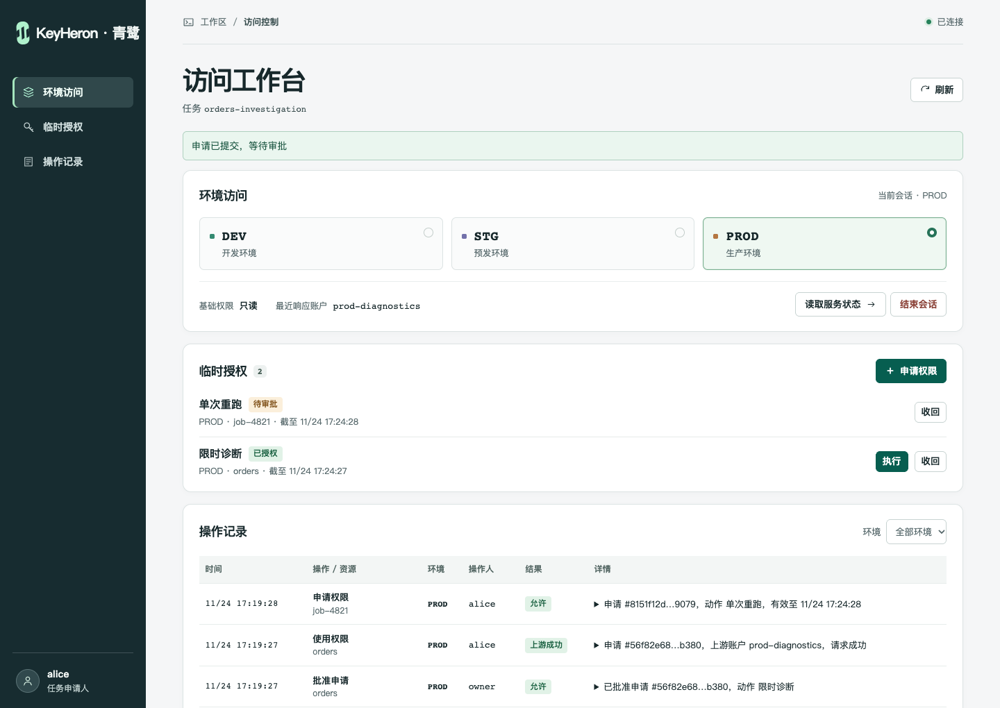

# KeyHeron（青鹭）

KeyHeron lets an agent call approved HTTPS endpoints across environments without receiving the upstream credential. A Rust broker enforces the destination, method, path and session lifetime. A local console records requests and handles temporary privileges.

青鹭面向需要让 Agent 使用已有 API 的开发者。选择环境后，代理才为匹配的请求添加该环境的凭据。申请人和审批人通过不同的本地会话操作，环境切换、审批、代理使用和撤销写入 SQLite。预览版本面向受信宿主上的单个任务。



## 五分钟起步

从 GitHub 的 Releases 下载同一版本的源码包及对应平台的 Rust 程序，按包中的 SHA256SUMS 验证；或在检出仓库后按下面的命令从源码构建。需要 Python 3.10+、OpenSSL、curl、Rust 工具链及系统 C 编译器。CI 使用 Python 3.12 和 Rust 1.99.1。

```sh
git clone https://github.com/Harry813/keyheron.git
cd keyheron
cargo build --release --locked --manifest-path rust-core/Cargo.toml
python3 verify_external.py
```

最后一条命令会临时创建两个真正要求认证的 HTTPS 测试服务，用 curl 和 Python 原生客户端走一遍读取、权限审批、写操作及撤销；结束后自动清理。它只使用合成密钥，无需 GitHub 账号或云端密码。要接入自己的服务，请继续看[真实接入指南](docs/QUICKSTART.md)。

## 接入方式

- **已有 HTTP 客户端**：用 `python3 keyheron.py serve --config policy.json` 启动，然后用 `python3 keyheron.py run --env DEV -- <命令>` 运行支持 HTTPS 代理的客户端。它访问原 URL，获得仅针对一个环境和一条只读路径的短时会话。命令结束或启动器收到 TERM、HUP、INT 时会立即请求撤销。启动器被强杀时由服务端 TTL 兜底。上游只接收管理员配置的认证头。
- **临时高权限**：在工作台申请限时诊断或一次性写操作。审批范围固定到配置的环境、资源、路径和参数。可信服务代为执行。支持幂等的写端点接收操作编号；真实服务返回的 HTTP 受理状态不能证明异步业务已经完成。
- **试用操作界面**：也可以运行 `python3 tools.py --install` 和 `python3 web_demo.py --open`。这个兼容演示通过独立的 KeyFence 进程访问模拟订单服务，使用合成账户；真实 HTTPS 接入使用 Rust 原生代理，无需安装 KeyFence。[演示说明](docs/LOCAL-DEMO.md)
- **前端单独维护**：`web/` 是不依赖 Node.js 的静态前端，与后端通过同源 JSON API 协作。独立 Web 发行包也含许可证和版权声明。[前端说明](web/README.md)

## 验证与适用范围

`python3 verify_external.py --benchmark --samples 200` 测量本机经过证书验证的 HTTPS 直连与代理链路，区分客户端新连接、连接复用和不同并发。兼容演示的 `bench.py` 可另行比较直连、KeyFence 和完整审计路径；它的历史 HTTP 结果不代表真实服务的公网延迟。

当前控制台及代理只监听回环接口，角色凭据只适用于本次运行。配置文件和上游凭据由可信宿主管理。运行不可信代码时须另外隔离文件、进程、网络和管理接口。生产环境还需接入真实身份提供方、隔离审批人并建立审计归档。[安全边界与私密报告](SECURITY.md)

## 许可与贡献

原创代码采用 Apache License 2.0，Copyright 2026 Harry Wang。KeyFence 及 Rust 依赖保留各自的许可。[许可证](LICENSE) · [归属声明](NOTICE) · [贡献指南](CONTRIBUTING.md) · [变更记录](CHANGELOG.md)
